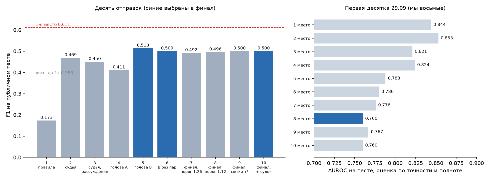
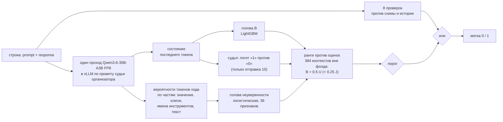

# aij-guardian

Детектор контекстных галлюцинаций в ходе LLM-агента. Задача Guardian of Truth, AI Journey Contest 2026 (Сбер).

На входе один ход агента: `prompt` (всё, что агент видел до хода: инструкции, политика, схемы инструментов, диалог и ответы инструментов) и `response` (сам ход, текст и вызовы инструментов). На выходе один бит: есть ли в ходе утверждение или действие, не обоснованное контекстом. Метрика F1 по классу «галлюцинация».

## Итог

Лучшая отправка дала **F1 0.513** на публичном тесте: 77 верных из 170 пометок при 130 ошибках в тесте. Это восьмое место в первой десятке таблицы на 29.09.2026, у первого места 0.611. В финал выбраны отправки 5, 6 и 10 ([DECISIONS 49](docs/DECISIONS.md)).



Что получилось:

- решение, которое за один проход модели организатора по строке читает из неё два сигнала (состояние последнего токена и вероятности токенов хода) и укладывается во время платформы с запасом 2.3x: 776 с на 548 строк на A100 ([rental_timing.json](results/rental_timing.json));
- восстановленный из таблицы лидеров состав теста (548 строк, 130 ошибок) и модель, которая переводит F1 любой отправки в число верных пометок и в AUROC на тесте ([budget_model.json](results/budget_model.json));
- воспроизводимый учёт: каждое число этого текста лежит в `results/` и пересчитывается `scripts/verify_numbers.py`.

Что не получилось: домашняя мера качества не предсказывает тест. На наших метках система ранжирует ходы с AUROC 0.934–0.987, на тесте около 0.74–0.77, у первой четвёрки таблицы 0.82–0.85. Всё, что мы меняли в последние дни (порог, метки действий, вторая модель признаков, сигнал судьи), дало на тесте от 0.492 до 0.500. Разбор ниже, в разделе [«Почему домашняя мера разошлась с тестом»](#почему-домашняя-мера-разошлась-с-тестом).

## Задача и данные

Организатор выдаёт один размеченный файл: 46 строк, 23 с ошибкой (у каждой объяснение) и 23 без ([eda.json](results/eda.json)). Обучающего набора нет.

Размер теста не раскрыт, но восстанавливается из таблицы лидеров: у каждой команды P × recall обязано быть целым, и три отправки «всё помечено единицей» дают число строк. Получается **548 строк, 130 ошибок, доля 0.2372**, и все 54 опубликованных F1 на 20.09 воспроизводятся из целых счётчиков ([leaderboard_forensics.json](results/leaderboard_forensics.json)).

Данные построены на открытом бенчмарке [τ²-bench](https://github.com/sierra-research/tau2-bench) (MIT): политики airline и retail построчно совпадают с файлами бенчмарка, у telecom файл бенчмарка целиком содержится в контексте ([tau2_match.json](results/tau2_match.json)). Диалоги на русском, политика и схемы инструментов на английском. Отсюда два следствия: базы, инструменты и эталонные действия задач открыты, и можно симулировать похожие диалоги самим.


## Решение



| Часть | Что делает | Где в коде |
|---|---|---|
| Проверки | вызов инструмента не из списка, заблокированный инструмент, неизвестный или пропущенный аргумент, значение вне перечисления, повтор упавшего вызова, идентификатор, которого нет в контексте, «замена» на то же значение | [`rules.py`](src/guardian/rules.py) |
| Проход модели | промпт судьи организатора, один проход vLLM с выдачей состояний всех позиций; из них состояние последнего токена и для каждого токена хода логарифм вероятности, энтропия и зазор двух лучших | [`extract.py`](src/guardian/extract.py), [`final_pass.py`](scripts/final_pass.py) |
| Голова B | LightGBM 300 деревьев по 7 листьев на векторе последнего токена, три зерна с разными четвертями написанных пар | [`tau2ru_ruler.py`](scripts/tau2ru_ruler.py) |
| Голова неуверенности | логистическая регрессия на 36 признаках вероятностей токенов хода: 12 по всему ходу, по 6 на значения аргументов, имена аргументов, имена инструментов и текст | [`uncertainty.py`](src/guardian/uncertainty.py) |
| Сборка | каждая голова переводится в ранг против своих оценок на 384 контекстах вне фолда, так что строка решается сама по себе, а не как доля файла; абсолютный порог; правило или порог дают 1 | [`final.py`](src/guardian/final.py), [`predict.py`](scripts/predict.py) |

Отправки 5 и 6 устроены проще: логистическая голова B на векторе последнего токена с сервера vLLM и решение «правило или верхние 30 % оценок файла». Отправки 7–10 это система со схемы выше; отказ от доли файла в пользу абсолютного порога записан в [DECISIONS 47](docs/DECISIONS.md).

Если проход модели не успел до дедлайна, строки без оценки получают метку проверок. Головы обучены на признаках того же движка, что на платформе: для этого признаки FP8 считались на арендованной A100 ([docs/RENTAL.md](docs/RENTAL.md)).

### Обучающие данные

Все метки, кроме 46 строк организатора, поставлены моделями: локальной Qwen3.6 и Claude Opus. Человек их не проверял.

| Источник | Строк в финальной системе | Метки |
|---|---:|---|
| Ходы из истории 46 диалогов организатора (у каждого хода свой контекст) | 384 из 40 задач | v1s: локальная Qwen3.6 с эталоном задачи τ² и рассуждением; вторая разметка Claude Opus для проверки |
| Симуляции τ² на русском (агент Qwen3.6 или GLM-4.7-Flash, пользователь локальная модель), четыре набора | 1074 после фильтров | Claude Opus с эталоном задачи |
| Шаги τ² из AgentProcessBench и TrajErrBench (MIT), часть `ext_dev` | 3626 | разметка самих наборов, вес половина русских строк |
| Написанные минимальные пары (ход с одной внесённой ошибкой) | 482 | по построению, с проверкой Opus |

Число строк из [final_fp8_ruler.json](results/final_fp8_ruler.json). В отправках 9 и 10 ходы с вызовами инструментов получили метку по эталонным действиям τ² ([gold_labels.py](scripts/gold_labels.py)).

## Как мерили

Размеченных строк организатора 46, и все их объяснения прочитаны при построении проверок и промптов разметчиков, поэтому валидацией они быть не могут. Основная линейка:

- 384 контекста организатора, пять фолдов по диалогам: ни один диалог не попадает одновременно в обучение и в оценку;
- AUROC системы вне фолда в трёх видах: контексты, где v1s и Opus согласны (343, из них 53 ошибки), все по v1s (384, 67 ошибок), все по Opus (384, 80 ошибок);
- разница двух вариантов считается парно, бутстрэпом по 40 диалогам;
- правило записывается до прогона: вариант заменяет текущий, только если интервал на согласных контекстах целиком выше нуля и у v1s и Opus тот же знак.

Связь с тестом даёт [budget_model.py](scripts/budget_model.py): из F1 (или точности и полноты) отправки восстанавливается пара «верных из помеченных», а через бинормальную ROC подразумеваемый AUROC на тесте. Это модель, а не измерение, но она прошла проверку заранее: подогнанная на отправке 5 (77 из 170), она предсказала для отправки 7 при 118 пометках 60.3 верных, на деле 61 ([threshold_choice.json](results/threshold_choice.json)).

## Результаты

### Отправки

| № | Что | F1 | Верных из помеченных | AUROC на тесте, оценка |
|---:|---|---:|---:|---:|
| 1 | только проверки | 0.173 | 13 из 20 | |
| 2 | судья организатора без рассуждения, правила или верхние 30 % | 0.469 | 71 из 173 | 0.716 |
| 3 | то же с рассуждением до 1024 токенов | 0.450 | | |
| 4 | голова A (метки только на ходах с вызовами) | 0.411 | | |
| **5** | **голова B, логистическая, 212 контекстов и пары** | **0.513** | **77 из 170** | **0.760** |
| 6 | голова B без пар | 0.500 | 75 из 170 | 0.747 |
| 7 | финальная система, порог 1.259 по максимуму F1 на контекстах | 0.492 | 61 из 118 | 0.765 |
| 8 | то же, порог 1.117 | 0.496 | 84 из 209 | 0.738 |
| 9 | то же, ходы с вызовами размечены по эталону τ² | 0.500 | около 84–85 из ~210 | |
| 10 | то же плюс судья из того же прохода, вес 0.25 | 0.500 | около 84–85 из ~210 | |

F1 из [submissions.csv](results/submissions.csv) (прочитаны на платформе), счётчики и AUROC из [submission_counts.json](results/submission_counts.json) и [budget_model.json](results/budget_model.json). У отправок 3 и 4 платформа показала только F1, и пара не восстанавливается однозначно; у 9 и 10 F1 ровно 0.5 допускает много пар, число пометок взято по тому же порогу, что у 8.

### Дома и на тесте

| | AUROC |
|---|---:|
| финальная система на наших метках: согласные / v1s / Opus | 0.987 / 0.937 / 0.934 |
| наши отправки на тесте, оценка | 0.738–0.765 |
| первая четвёрка таблицы на тесте, оценка | 0.821–0.853 |

Домашние числа из [paired_final_fp8_ruler__vs__reference__agreed.json](results/paired_final_fp8_ruler__vs__reference__agreed.json), [v1s](results/paired_final_fp8_ruler__vs__reference.json) и [Opus](results/paired_final_fp8_ruler__vs__reference__opus.json), тестовые из [budget_model.json](results/budget_model.json).

### Что проверено и не сработало

| Что пробовали | Дома | На тесте |
|---|---|---|
| Больше данных: сетка из 32 вариантов по симуляциям (все 9 наборов, без каждого, по доменам, веса, доли) | ни один не лучше базового набора; все 9 наборов −0.0023 [−0.0068; +0.0005] на согласных ([data_grid.json](results/data_grid.json)) | |
| Симуляции в финальной системе против системы без них | +0.0075 [−0.0011; +0.0164] на согласных, +0.0129 v1s, +0.0175 Opus ([paired](results/paired_final_fp8_ruler__vs__reference__agreed.json)) | |
| Признаки FP8 (платформа) против Q4 (дом) | −0.0026 [−0.0145; +0.0045] на согласных ([paired](results/paired_final_fp8_ruler__vs__grid_base__agreed.json)) | |
| Порог по максимуму F1 на контекстах | F1 v1s 0.758, при выборе на других фолдах 0.713 ([final_fp8_ruler.json](results/final_fp8_ruler.json)) | 0.492: пометил 118 строк, а при слабом ранжировании теста выгоднее помечать больше |
| Порог ниже, около 209 пометок | | 0.496: из 91 добавленной пометки ошибок 23, то есть 25 % при доле ошибок в тесте 23.7 % |
| Метки по эталону τ² на ходах с вызовами | на них v1s уже совпадает с эталоном в 180 из 190 ходов, Opus в 183 ([gold_labels.json](results/gold_labels.json)) | 0.500 |
| Судья организатора из того же прохода | один 0.879 на согласных; поверх системы +0.0001 [−0.0022; +0.0028] при весе 0.25 ([judge_signal.json](results/judge_signal.json)) | 0.500 |
| Gemma 4 26B-A4B вместо Qwen3.6 как источник признаков | −0.037 [−0.064; −0.013] на согласных, −0.049 v1s, −0.007 Opus ([model_swap.json](results/model_swap.json)) | не отправлялась |
| Рассуждение судьи до вердикта | | 0.450 против 0.469 без рассуждения |
| Голова на метках только ходов с вызовами | | 0.411 |

Отдельно о платформе: проход vLLM с MoE-моделью в FP8 на A100 неповторяем. Косинус векторов одной и той же строки между двумя проходами около 0.994, и между обучающим проходом и проходом решения меняются 11 меток из 384 ([rental_repeatability.json](results/rental_repeatability.json)). Это не зависит ни от пакета строк, ни от компиляции графа.

## Почему домашняя мера разошлась с тестом

Проверка по диалогам уже учитывает, что тест состоит из других диалогов, поэтому один сдвиг распределения разрыв 0.93–0.99 против 0.74–0.77 не объясняет. Остаются три причины, и данные говорят в пользу первой.

1. **Соглашение о том, что считать ошибкой.** Наши разметчики находят ошибки реже, чем организатор: v1s в 17.4 % контекстов (67 из 384), Opus в 20.8 % (80 из 384), в тесте 23.7 % (130 из 548). У организатора 21 из 23 ошибок размеченного файла приходится на ходы с вызовом инструмента, у v1s на такие ходы 29 из 67 ([gold_labels.json](results/gold_labels.json)). На ходах с вызовами наши метки почти совпадают с эталоном τ², поэтому расхождение, если оно есть, живёт в текстовых ходах, а их механически не разметить.
2. **Замкнутый круг.** Головы учатся на тех же метках, которыми их мерят. Круг несимметричен: по v1s своя разметка даёт голове B +0.001…0.008 AUROC, по Opus +0.019…0.029 ([label_circularity.json](results/label_circularity.json)).
3. **Насыщение линейки.** На согласных контекстах система уже на 0.987, и разницы в сотые доли AUROC, которые на тесте что-то значили бы, здесь неотличимы от шума.

Линейка при этом не бесполезна: при доле пометок, как в тесте, порядок четырёх ранних отправок она повторила ([ruler_vs_test.json](results/ruler_vs_test.json)). Но близкие варианты она не различает, и то, что дома лучше на сотую, на тесте могло оказаться хуже.

## Ограничения

- Метки обучающих данных поставлены моделями, человек их не проверял; единственная разметка организатора это 46 строк, отобранных им вручную поровну.
- AUROC на тесте и число пометок у отправок 9 и 10 это оценки по модели, а не измерения.
- Ответ платформы на одну и ту же строку не повторяется (около 3 % меток между двумя проходами).
- Данные организатора, метки и симуляции в репозиторий не входят: первые по правилам соревнования, остальные из-за объёма. Поэтому большинство скриптов без них не запустится, а `verify_numbers.py` пропускает проверки, для которых нет данных.

## Воспроизведение

```
uv venv .venv --python 3.11
uv pip install -e ".[dev]"
pytest

# контексты организатора из истории размеченных строк (нужен valid.parquet)
python scripts/extract_contexts.py
# проход модели дома: llama.cpp b11052, Qwen3.6-35B-A3B Q4_K_M, состояния и вероятности токенов хода
python scripts/embed_llama.py --rows data/synthetic/organizer_contexts.parquet --prefix q4_tok
python scripts/turn_tokens.py --prefix q4_tok
# линейка и выгрузка финальных голов (флаги как в scripts/rental.sh, шаг export)
python scripts/tau2ru_ruler.py --labels opus --quick --export submission_work/final.json ...
# признаки движка платформы, головы, порог и замер времени на арендованной A100
bash scripts/rental.sh setup && bash scripts/rental.sh model && bash scripts/rental.sh pass   # и далее по docs/RENTAL.md
# архив решения
python scripts/build_submission.py --strategy final --final submission_work/final_fp8_gold_judge.json \
    --prompt data/raw/baseline/baseline/src/hallucination_detector/prompt.md
# пересчёт опубликованных чисел
python scripts/verify_numbers.py
```

## Структура

```
src/guardian/      пакет решения: разбор транскриптов, проверки, проход модели, головы, судья
scripts/           измерения, разметка, симуляции, аренда, сборка архива (predict.py это точка входа решения)
configs/           промпты разметчиков и писателей пар, настройки llama-server
results/           все опубликованные числа, JSON и CSV, и оценки вне фолда для парных сравнений
tests/             парсер, проверки, контракт решения, финальная система
docs/              база знаний, решения, журнал, таблица прогонов, план, правила
```

## Документы

- [docs/DECISIONS.md](docs/DECISIONS.md): решения автора с датой и формулировкой
- [docs/EXPERIMENTS.md](docs/EXPERIMENTS.md): таблица прогонов
- [docs/RENTAL.md](docs/RENTAL.md): аренда A100 для признаков платформы и замера времени
- [docs/LITERATURE.md](docs/LITERATURE.md): обзор работ по теме
- [docs/LICENSES.md](docs/LICENSES.md): лицензии моделей
