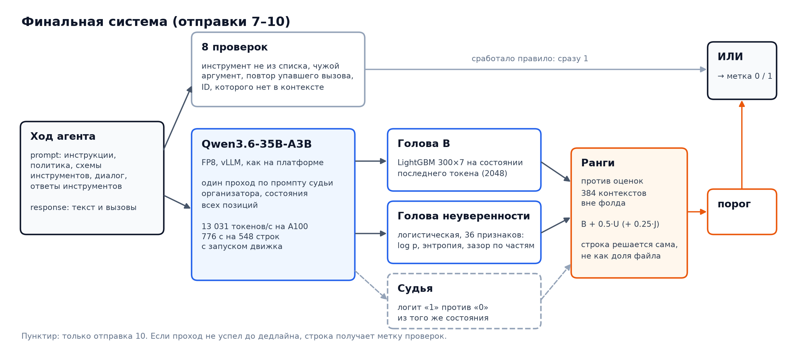
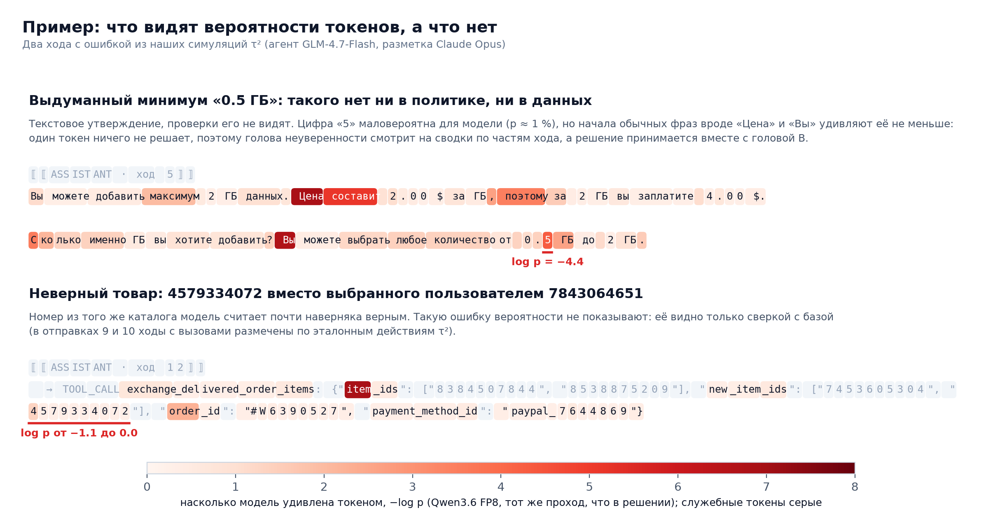
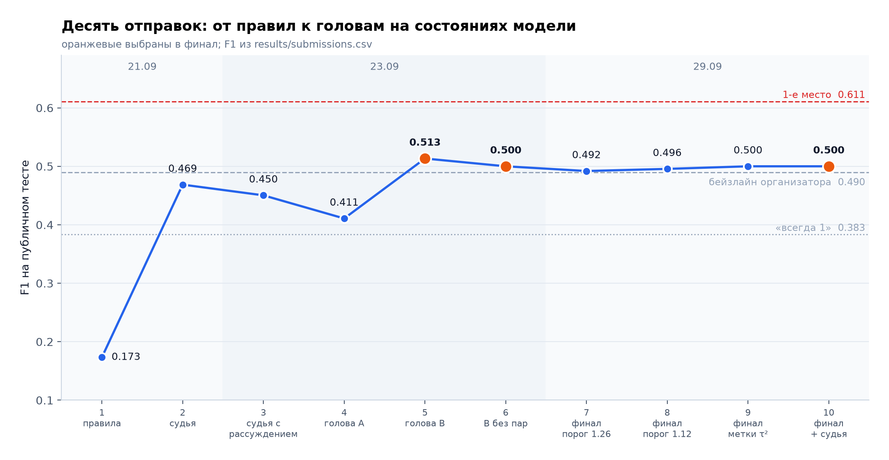
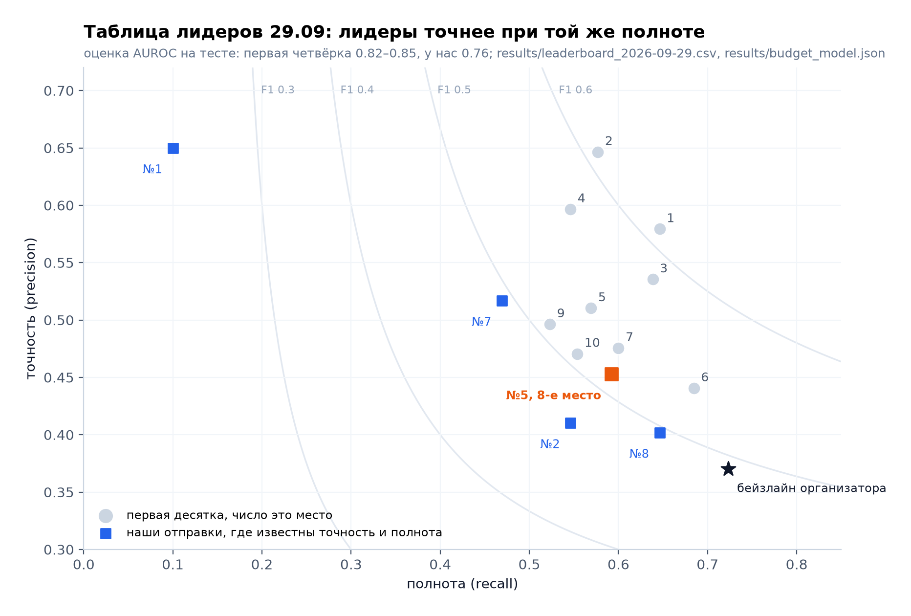
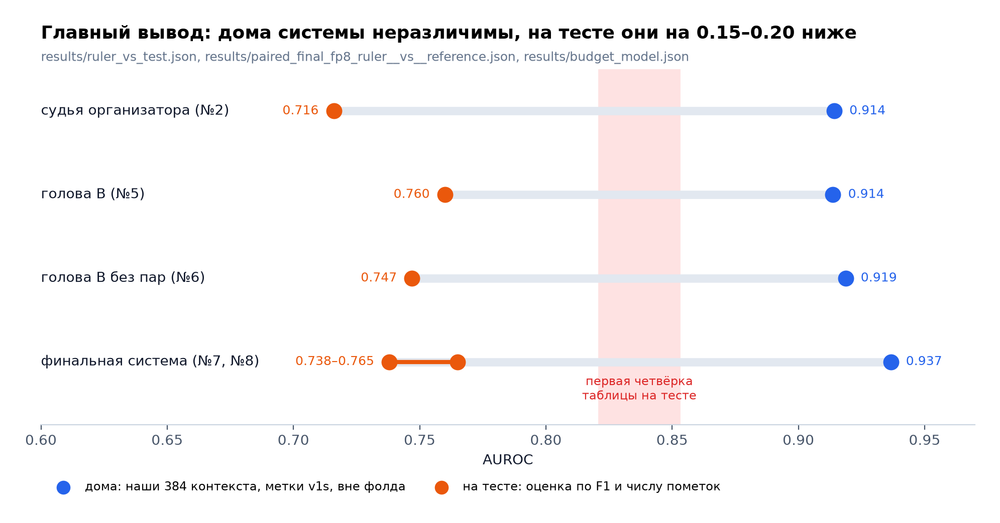
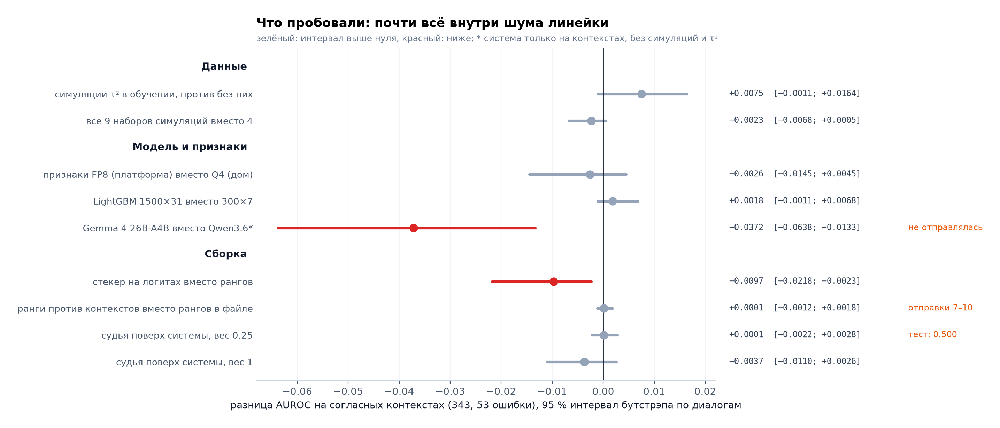

# Guardian of Truth: детектор галлюцинаций LLM-агента


Решение задачи Guardian of Truth на AI Journey Contest 2026 (Сбер). Агент поддержки ведёт диалог с клиентом и вызывает инструменты; по одному его ходу и всему, что он видел до этого хода, нужно решить, есть ли в ходе утверждение или действие, не обоснованное контекстом. Метрика F1 по классу «галлюцинация».

Решение читает ответ за один проход модели организатора: из состояния последнего токена и из вероятностей токенов хода две лёгкие головы получают оценку, а детерминированные проверки ловят нарушения схемы инструментов.



## Коротко

| | |
|---|---|
| **Итог на приватном тесте** | **42-е место из 180** в финальной таблице 11.11.2026 ([final_standings.json](results/final_standings.json)) |
| **F1 на публичном тесте** | **0.513**: 77 верных из 170 пометок при 130 ошибках в тесте; 8-е место в таблице на 29.09.2026 |
| **Бейзлайн организатора** | 0.490 на том же тесте, та же модель в роли судьи |
| **Время на платформе** | 776 с на 548 строк на A100 вместе с запуском движка: запас 2.3× к лимиту 30 минут |
| **Модель** | одна, Qwen3.6-35B-A3B из бейзлайна организатора; один проход на строку, без генерации |
| **Обучающие данные** | 384 хода агента организатора, 1074 хода наших симуляций τ², 3626 шагов τ² из открытых наборов, 482 минимальные пары |
| **Воспроизводимость** | каждое число этого текста лежит в `results/` и пересчитывается `scripts/verify_numbers.py` |

Три вывода проекта:

1. **Один проход модели без генерации даёт рабочий детектор.** Головы на состоянии и вероятностях токенов обошли на тесте и судью организатора (0.490), и наш судья на той же модели (0.469), а судья с рассуждением перед вердиктом оказался хуже судьи без него (0.450).
2. **Порог, объём данных, вторая модель и метки действий на тесте почти ничего не меняют.** Все варианты последних дней дали от 0.492 до 0.500.
3. **Предел задаёт соглашение о разметке, а не модель.** Дома, на наших метках, системы ранжируют ходы с AUROC 0.93–0.99, на тесте около 0.74–0.77. Разбор в разделе [«Главный вывод»](#главный-вывод-домашняя-мера-и-тест).

## Задача

На входе `prompt` (инструкции агента, политика домена, схемы инструментов, диалог и ответы инструментов, в среднем десятки тысяч символов) и `response` (сам ход: текст и вызовы инструментов). Пример в формате данных, составлен нами:

```
⟦USER⟧  Хочу вернуть заказ. Я Юсуф Росси, почта yusuf.rossi7301@example.com
⟦ASSISTANT · ход 3⟧
	→ TOOL_CALL find_user_id_by_name_zip: {"first_name": "Yusuf", "last_name": "Rossi", "zip": "7301"}
```

Индекс `7301` агент взял из адреса почты: клиент его не называл. Это галлюцинация (значение аргумента не обосновано контекстом), и её ловит проверка `unsupported_argument_value`. Труднее ход «Возврат оформлен, деньги придут за 5–7 дней» без вызова инструмента: заявлено действие, которого не было, и правилами такое не поймать.

Что известно о данных:

- размеченных строк 46: 23 с ошибкой (у каждой объяснение организатора) и 23 без ([eda.json](results/eda.json)); обучающего набора нет;
- размер теста не раскрыт, но восстанавливается из таблицы лидеров: **548 строк, 130 ошибок**; все 54 опубликованных F1 на 20.09 воспроизводятся из целых счётчиков ([leaderboard_forensics.json](results/leaderboard_forensics.json));
- данные построены на открытом бенчмарке [τ²-bench](https://github.com/sierra-research/tau2-bench) (MIT): политики построчно совпадают с файлами бенчмарка ([tau2_match.json](results/tau2_match.json)), диалоги переведены на русский;
- платформа: одна A100 80 ГБ, 30 минут на весь тест, архив до 40 ГБ, без сети; в образе vLLM 0.19.1 и Qwen3.6-35B-A3B в FP8.

## Как устроено решение

| Часть | Что делает | Почему так |
|---|---|---|
| **Проверки** ([rules.py](src/guardian/rules.py)) | 8 проверок хода против схемы инструментов и истории: инструмент не из списка, чужой или пропущенный аргумент, значение вне перечисления, повтор упавшего вызова, ID, которого нет в контексте | точны (на тесте 13 верных из 20 срабатываний), но покрывают около 10 % ошибок; сработавшая проверка сразу даёт 1 |
| **Проход модели** ([extract.py](src/guardian/extract.py), [final_pass.py](scripts/final_pass.py)) | vLLM отдаёт состояния всех позиций на промпте судьи организатора; из них берётся состояние последнего токена и для каждого токена хода log p, энтропия и зазор двух лучших вариантов | 548 строк по десятку тысяч токенов не оставляют времени на генерацию; проход идёт в отдельном процессе с дедлайном |
| **Голова B** | LightGBM, 300 деревьев по 7 листьев, на векторе последнего токена (2048); три зерна | линейная голова этого сигнала отправлялась в №5 и №6; бустинг на всех данных дома не хуже |
| **Голова неуверенности** ([uncertainty.py](src/guardian/uncertainty.py)) | логистическая регрессия на 36 сводках вероятностей: по всему ходу и отдельно по значениям аргументов, именам аргументов, именам инструментов и тексту | выдуманное значение часто маловероятно для самой модели |
| **Сборка** ([final.py](src/guardian/final.py)) | ранг каждой головы против её оценок на 384 контекстах вне фолда, B + 0.5·U, абсолютный порог | строка решается сама по себе, а не как доля файла ([DECISIONS 47](docs/DECISIONS.md)) |

Если проход модели не успел до дедлайна, строки без оценки получают метку проверок. Головы обучены на признаках того же движка, что на платформе: признаки FP8 считались на арендованной A100, а веса с хаба сверены с копией организатора по SHA-256 (21 тензор, [weights_fingerprint.json](results/weights_fingerprint.json), [docs/RENTAL.md](docs/RENTAL.md)).

## Пример: что видят вероятности токенов



Вероятности токенов помогают там, где ошибка это выдуманный факт: модель, которая видела весь контекст, сама считает его маловероятным. Но сигнал шумный, а ошибки выбора (верный по форме ID, но не тот) он не видит вовсе. Поэтому в системе две головы и проверки.

## Данные для обучения

Все метки, кроме 46 строк организатора, поставлены моделями: локальной Qwen3.6 и Claude Opus. Человек их не проверял.

| Источник | Строк | Метки |
|---|---:|---|
| Ходы из истории 46 диалогов организатора, каждый со своим контекстом | 384 из 40 задач | v1s: локальная Qwen3.6 с эталоном задачи τ² и рассуждением; вторая разметка Claude Opus |
| Наши симуляции τ² на русском: агент Qwen3.6 или GLM-4.7-Flash, пользователь локальная модель | 1074 после фильтров | Claude Opus с эталоном задачи |
| Шаги τ² из AgentProcessBench и TrajErrBench (MIT) | 3626 | разметка самих наборов, вес половина русских строк |
| Минимальные пары: ход организатора с одной ошибкой, внесённой Claude | 482 | по построению, с проверкой Opus |

Число строк из [final_fp8_ruler.json](results/final_fp8_ruler.json). В отправках 9 и 10 ходы с вызовами размечены механически, по эталонным действиям τ² ([gold_labels.py](scripts/gold_labels.py)).

## Как мерили

Все 46 объяснений организатора прочитаны при построении проверок и промптов разметчиков, поэтому валидацией эти строки быть не могут. Основная линейка:

- 384 контекста организатора, пять фолдов по диалогам: диалог не попадает одновременно в обучение и в оценку;
- AUROC вне фолда в трёх видах: контексты, где v1s и Opus согласны (343, из них 53 ошибки), все по v1s (384 и 67), все по Opus (384 и 80);
- разница вариантов считается парно, бутстрэпом по 40 диалогам;
- правило записывается до прогона: вариант заменяет текущий, только если интервал на согласных контекстах целиком выше нуля и у v1s и Opus тот же знак.

Мостик к тесту даёт [budget_model.py](scripts/budget_model.py): по F1 (или точности и полноте) восстанавливается пара «верных из помеченных», а через бинормальную ROC подразумеваемый AUROC на тесте. Это модель, но проверенная заранее: подогнанная на отправке 5 (77 из 170), она предсказала для отправки 7 при 118 пометках 60.3 верных, на деле 61 ([threshold_choice.json](results/threshold_choice.json)).

## Результаты



| № | Что | F1 | Верных из помеченных | AUROC на тесте, оценка |
|---:|---|---:|---:|---:|
| 1 | только проверки | 0.173 | 13 из 20 | |
| 2 | судья организатора без рассуждения, проверки или верхние 30 % | 0.469 | 71 из 173 | 0.716 |
| 3 | то же с рассуждением до 1024 токенов | 0.450 | | |
| 4 | голова A (метки только на ходах с вызовами) | 0.411 | | |
| **5** | **голова B, логистическая, 212 контекстов и пары** | **0.513** | **77 из 170** | **0.760** |
| 6 | голова B без пар | 0.500 | 75 из 170 | 0.747 |
| 7 | финальная система, порог 1.259 по максимуму F1 на контекстах | 0.492 | 61 из 118 | 0.765 |
| 8 | то же, порог 1.117 | 0.496 | 84 из 209 | 0.738 |
| 9 | то же, ходы с вызовами размечены по эталону τ² | 0.500 | около 84–85 из ~210 | |
| 10 | то же плюс судья из того же прохода, вес 0.25 | 0.500 | около 84–85 из ~210 | |

F1 из [submissions.csv](results/submissions.csv) (прочитаны на платформе), счётчики и AUROC из [submission_counts.json](results/submission_counts.json) и [budget_model.json](results/budget_model.json). У №3 и №4 платформа показала только F1, и пара не восстанавливается однозначно; у №9 и №10 F1 ровно 0.5 допускает много пар, число пометок взято по тому же порогу, что у №8. В финал выбраны №5, №6 и №10 ([DECISIONS 49](docs/DECISIONS.md)).



Лидеры отличаются от нас не порогом, а качеством ранжирования: при той же полноте они точнее. По той же модели их AUROC на тесте 0.82–0.85 против нашего 0.76.

## Главный вывод: домашняя мера и тест



Проверка по диалогам уже учитывает, что тест состоит из других диалогов, поэтому один сдвиг распределения разрыв 0.93–0.99 против 0.74–0.77 не объясняет. Остаются три причины, и данные говорят в пользу первой.

1. **Соглашение о том, что считать ошибкой.** Наши разметчики находят ошибки реже организатора: v1s в 17.4 % контекстов (67 из 384), Opus в 20.8 % (80 из 384), в тесте 23.7 % (130 из 548). У организатора 21 из 23 ошибок размеченного файла приходится на ходы с вызовом инструмента, у v1s 29 из 67. На ходах с вызовами наши метки почти совпадают с эталоном τ² (v1s в 180 из 190), так что расхождение живёт в текстовых ходах, а их механически не разметить ([gold_labels.json](results/gold_labels.json)).
2. **Замкнутый круг.** Головы учатся на тех же метках, которыми их мерят: по v1s своя разметка даёт голове B +0.001…0.008 AUROC, по Opus +0.019…0.029 ([label_circularity.json](results/label_circularity.json)).
3. **Насыщение.** На согласных контекстах система уже на 0.987, и разницы в тысячные доли, которые на тесте что-то значили бы, неотличимы от шума.

Линейка при этом не бесполезна: при доле пометок, как в тесте, порядок четырёх ранних отправок она повторила ([ruler_vs_test.json](results/ruler_vs_test.json)). Но близкие варианты она не различает.

## Что пробовали



Что проверялось только на тесте:

| Что | Итог |
|---|---|
| Порог по максимуму F1 на контекстах (№7) | 0.492: пометил 118 строк; дома точность верхних строк высокая (50 из 65), на тесте нет |
| Порог ниже, около 209 пометок (№8) | 0.496: из 91 добавленной пометки ошибок 23, то есть 25 % при доле ошибок в тесте 23.7 % |
| Метки по эталону τ² на ходах с вызовами (№9) | 0.500: меняют 10 меток контекстов из 384 |
| Судья из того же прохода поверх системы (№10) | 0.500: его оценка сильно совпадает с головой B и почти не меняет решений |
| Рассуждение судьи перед вердиктом (№3) | 0.450 против 0.469 без рассуждения |
| Голова на метках только ходов с вызовами (№4) | 0.411 |

## Инженерная часть

- **Решение без зависимостей и сети.** Архив ставится `pip install` без единого пакета; бустинг выгружается в JSON и на платформе обходится numpy, без LightGBM ([final.py](src/guardian/final.py)).
- **Признаки платформы дома не повторить.** Та же модель в Q4 на другой машине давала другие векторы, поэтому головы, порог и замер времени считались на арендованной A100 с тем же движком. Там же найдено, что vLLM с MoE-моделью в FP8 на A100 неповторяем: косинус векторов одной строки между двумя проходами около 0.994, и между обучающим проходом и проходом решения меняются 11 меток из 384 ([rental_repeatability.json](results/rental_repeatability.json)).
- **Состав теста без доступа к тесту.** Число строк и ошибок восстановлено из опубликованных точности и полноты всех команд, а по F1 каждой нашей отправки восстанавливается число верных пометок.
- **Честный учёт.** Правило решения записывается до прогона; каждое опубликованное число пересчитывается скриптом; тесты покрывают парсер транскриптов, проверки, контракт решения и финальную систему.

## Ограничения

- Метки обучающих данных поставлены моделями, человек их не проверял; единственная разметка организатора это 46 строк, отобранных им вручную поровну.
- AUROC на тесте и число пометок у №9 и №10 это оценки по модели, а не измерения.
- Разбиение хода на части считает элементы массивов (например, ID в `item_ids`) служебными токенами, а не значениями аргументов, так что сводки по значениям их не видят.
- Данные организатора, метки и симуляции в репозиторий не входят: первые по правилам соревнования, остальные из-за объёма. Большинство скриптов без них не запустится, и `verify_numbers.py` целиком проходит только на машине с данными.

## Воспроизведение

```
uv venv .venv --python 3.11
uv pip install -e ".[dev]"
pytest

# контексты организатора из истории размеченных строк (нужен valid.parquet)
python scripts/extract_contexts.py
# проход модели дома: llama.cpp b11052, Qwen3.6-35B-A3B Q4_K_M
python scripts/embed_llama.py --rows data/synthetic/organizer_contexts.parquet --prefix q4_tok
python scripts/turn_tokens.py --prefix q4_tok
# признаки движка платформы, финальные головы, порог и замер времени на A100 (docs/RENTAL.md)
bash scripts/rental.sh setup && bash scripts/rental.sh model && bash scripts/rental.sh pass && bash scripts/rental.sh export
# архив решения
python scripts/build_submission.py --strategy final --final submission_work/final_fp8_gold_judge.json \
    --prompt data/raw/baseline/baseline/src/hallucination_detector/prompt.md
# пересчёт опубликованных чисел и рисунков
python scripts/verify_numbers.py
python scripts/readme_figures.py
```

## Структура

```
src/guardian/      пакет решения: разбор транскриптов, проверки, проход модели, головы, сборка
scripts/           измерения, разметка, симуляции, аренда, сборка архива; predict.py это точка входа решения
configs/           промпты разметчиков и писателей пар, настройки llama-server
results/           все опубликованные числа (JSON, CSV) и оценки вне фолда для парных сравнений
tests/             парсер, проверки, контракт решения, финальная система
docs/              решения, таблица прогонов, аренда, литература, лицензии; docs/img это рисунки README
```

## Документы

- [DECISIONS.md](docs/DECISIONS.md): решения с датой и причинами
- [EXPERIMENTS.md](docs/EXPERIMENTS.md): таблица прогонов
- [RENTAL.md](docs/RENTAL.md): аренда A100 для признаков платформы и замера времени
- [LITERATURE.md](docs/LITERATURE.md): обзор работ по теме
- [LICENSES.md](docs/LICENSES.md): лицензии моделей и открытых наборов данных

## Лицензия

Код под лицензией MIT ([LICENSE](LICENSE)). Лицензии моделей и открытых наборов данных в [docs/LICENSES.md](docs/LICENSES.md); данные организатора в репозиторий не входят.
